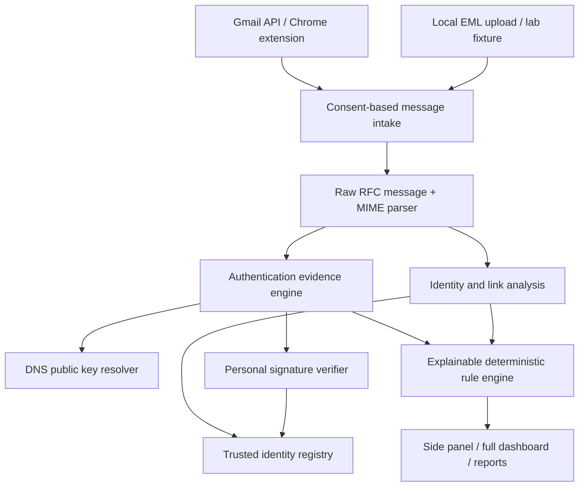

# MailShield — Project Context & Implementation Specification

**Academic title:** A Cryptography-Based Email Sender Authentication and Identity Impersonation Detection Framework  
**Project type:** Undergraduate Information Security semester project | **Team:** 2 developers | **ML/LLM dependency:** None  
**Primary product:** Chrome extension for Gmail + local verification service + interactive security dashboard and laboratory.

## 1. Project overview
MailShield helps ordinary email users understand whether a message really originates from the person or organization it claims to represent. It combines cryptographic email authentication, a trusted identity registry, deterministic impersonation rules and understandable security explanations. The system must analyze genuine email data, not simply display preprogrammed phishing warnings.

The motivating scenario is an email displaying the name and profile picture of Microsoft, a university professor or a public figure, while actually originating from an unrelated account. A non-technical recipient may mistake visual branding for evidence of identity. MailShield exposes that distinction directly in the reading workflow and explains what evidence supports its conclusion.

## 2. Problem statement and motivation
- Display names, avatars, logos and email footers are not cryptographic identity credentials; anyone can reproduce them. A lookalike address may resemble an official one without being the same address.
- A deceptive email sent from the impersonator's own legitimate account can pass SPF, DKIM and DMARC. Those checks do not automatically establish that its display name belongs to the claimed person or brand.
- Gmail already has authentication and anti-phishing defenses. This project is an additional explainable, user-configurable layer, not a claim of a newly discovered Gmail vulnerability or a replacement for Gmail's protection.
- Ordinary users need a readable warning, an explanation of the actual sender and a safe action to take, rather than raw hexadecimal strings or protocol jargon.
- Academic value: demonstrate hashing, asymmetric cryptography, digital signatures, DNS-based public-key distribution, PKI, integrity, authenticity and trust management in a useful software system.

## 3. Goals and non-goals
- **G1:** Analyze selected Gmail messages and uploaded RFC email (`.eml`) files through one shared engine.
- **G2:** Verify supported DKIM signatures from original message bytes; distinguish receiver-reported SPF/DMARC from independently verified evidence.
- **G3:** Match a claimed organization or individual against an explicitly trusted registry and flag discrepancies.
- **G4:** Demonstrate personal public-key fingerprint verification using signed email and independently enrolled keys.
- **G5:** Provide a polished Gmail side panel, a technical evidence explorer and an interactive educational laboratory.
- **G6:** Evaluate detection with reproducible labeled fixtures, including legitimate mail, impersonation, tampering and ambiguous cases.
- **Non-goals:** No ML training, LLM API, global identity database, automatic proof of a stranger's real-world identity, automatic email deletion, credential collection, sending forged emails, or production-grade phishing protection guarantees.

## 4. Core security model — what a hash can and cannot prove
A message digest such as SHA-256 identifies the hashed bytes; it changes when those bytes change. It is not a permanent sender ID. A public-key fingerprint identifies a specific public key and can be compared with a previously verified reference. A digital signature proves that a corresponding private key signed the covered data, subject to algorithm and verification assumptions. Identity still depends on how that key was bound to a trusted person or organization.

| Mechanism | What it establishes | Important limitation |
|---|---|---|
| SHA-256 digest | Integrity relative to a trusted reference digest | Anyone can recompute an unsigned digest. |
| DKIM | Signing domain and integrity of covered message data | Domain key, not necessarily an individual's key; not all fields are necessarily signed. |
| SPF | Sending IP authorization for envelope identity | Not a signature; cannot be reconstructed reliably from arbitrary forwarded/exported mail. |
| DMARC | Alignment of a passing SPF or DKIM identity with visible From domain | A pass does not prove the display name or that content is benign. |
| S/MIME | Signature by certificate-associated key over signed MIME content | Certificate trust, identity binding, coverage and revocation matter. |
| OpenPGP (stretch) | Signature by a particular OpenPGP key | Key ownership must be established independently. |

For a DKIM or X.509 public key, define a project-specific fingerprint as `SHA256(DER SubjectPublicKeyInfo)` encoded in hexadecimal; label it as a key fingerprint, not a certificate fingerprint. A certificate fingerprint hashes the whole certificate and can change on renewal. OpenPGP uses its own standard version-dependent fingerprint rules. Never hash the display name or email address and call it cryptographic identity verification.

## 5. Intended users and main workflow
- Non-technical Gmail users: quickly identify impersonation indicators and understand recommended precautions.
- Security-aware users: inspect signing domains, signature coverage, DNS records, key fingerprints and identity provenance.
- Students and teachers: experiment with signed messages and see exactly why different checks succeed or fail.
- Flow: select message → explicitly analyze → parse original bytes → verify available evidence → resolve claimed identity → run rules → show verdict and explanation → optionally inspect technical details or save a redacted report.
- Default UX must show a warning like “This email is authenticated for its own domain, but that domain is not registered as representing the claimed organization” rather than “DKIM passed, therefore safe.”

## 6. Scope and priorities
| Priority | Deliverable | Definition of done |
|---|---|---|
| P0 — required | `.eml` analyzer + deterministic rule engine | Real parsing, DKIM verification, identity matching and explainable findings. |
| P0 — required | Trusted identity registry | Add/edit identities, aliases, domains and provenance; distinguish verified vs user-trusted vs unverified. |
| P0 — required | Full web dashboard + lab | Real analysis results, fixture comparison, signing/verification demonstrations. |
| P0 — required | Gmail extension | User-authorized retrieval and analysis of at least one real message in a test account, subject to OAuth feasibility. |
| P1 — advanced | Personal S/MIME signatures | Validate signed test messages against a local trusted CA or independently enrolled key; show tampering and wrong-key cases. |
| P1 — advanced | Key history, reports and batch fixture evaluation | Explain rotation, export redacted findings and evaluate detection. |
| P2 — stretch | OpenPGP, Workspace add-on, ARC validation, mailbox-wide opt-in scan | Only after P0/P1 are stable and privacy/permissions are reviewed. |

## 7. System architecture


- React/TypeScript web app and Chrome Manifest V3 side panel share UI components, result schemas and labels. FastAPI provides local analysis APIs; SQLite persists user-approved registry entries and optional redacted results.
- Run the verification service on loopback by default. Original messages are processed in memory and discarded after analysis unless explicit local retention is requested. Gmail OAuth credentials stay in the extension's authorized token flow; never forward them to the analyzer.
- The DNS resolver queries only validated authentication-record names; support timeouts, TTL-aware caching, fixture DNS responses and distinct network-error states. The service must not visit links or load remote email images.
- Keep lab mode isolated from live-message analysis. Simulated messages and local CA keys are clearly labeled and cannot silently become real trusted identities.

## 8. Suggested technology stack
| Layer | Technology |
|---|---|
| Web UI | React, TypeScript, Vite, Tailwind CSS, accessible component primitives, Lucide icons |
| Extension | Chrome Manifest V3, Side Panel API, `chrome.identity`, narrowly scoped permissions |
| Backend | Python, FastAPI, Pydantic, Uvicorn |
| Email/MIME | Python `email` package; original bytes retained for signature verification |
| Cryptography | dkimpy, cryptography, OpenSSL CMS verification for S/MIME; established libraries only |
| DNS and domains | dnspython, IDNA, maintained public-suffix library, Unicode UTS #39 data, RapidFuzz |
| Persistence | SQLite, SQLAlchemy or SQLModel, migrations |
| Tests/deployment | pytest, Vitest, Playwright, Docker Compose (optional local packaging) |

Pin compatible dependencies and validate library feature support before implementing; do not implement cryptographic primitives from scratch. Avoid unnecessary microservices, cloud services and paid APIs.

## 9. Gmail integration and message acquisition
- Use a Chrome extension side panel that stays beside Gmail, with a clear “Analyze message” action. Show connected account, consent state, selection status, disconnect and privacy settings.
- Use an OAuth client configured for the extension and Gmail API in a Google Cloud project. For the prototype, use developer/test accounts explicitly allowed by the consent configuration. `gmail.readonly` is a restricted scope; do not request send, modify or full mailbox access beyond read-only capability.
- Explain that a read-only token can technically read other mail too; enforce selected-message-only access in the application and never pretend OAuth scope is per-message if it is not. Public deployment may require Google verification and a security assessment depending on data handling.
- Use `users.messages.get` with `format=raw` and decode base64url to obtain original message bytes. `metadata` format/scope alone is insufficient for body signature checks. Never reconstruct signed content from Gmail's rendered HTML or extracted DOM text.
- Gmail's UI identifiers may not be stable API IDs. Validate any selected-message mapping against the authorized API; provide a consented message picker using Gmail API IDs if DOM integration is unreliable. Analyze one message within a thread, not an ambiguous whole-thread view.
- Fallback: Gmail → three-dot menu → Show original → download original `.eml` → import into MailShield. Support drag-and-drop and raw header paste (header-only results must clearly show unavailable body/signature checks).
- A native Google Workspace add-on using current-message scopes is an optional alternate integration, not an additional mandatory frontend. Do not assume it exposes every raw message capability without testing.

## 10. Authentication and cryptographic verification engine
### 10.1 Parsing and evidence collection
- Parse RFC message headers and MIME parts using a maintained parser; capture From, display name, Sender, Reply-To, Return-Path, Date, Message-ID, Received, Authentication-Results, DKIM-Signature and ARC fields when present.
- Preserve repeated headers and raw bytes; decode encoded words and internationalized addresses safely. Malformed or multiple From identities are ambiguous and must not silently be reduced to one trusted identity.
- Evidence records include source (`local_crypto`, `trusted_receiver`, `untrusted_header`, `registry`, `heuristic`, `lab`), result, coverage, reason, observed time and relevant domains. Distinguish `pass`, `fail`, `missing`, `unknown`, `temporary_error`, `unsupported` and `untrusted`.
### 10.2 DKIM verification
- Extract each DKIM signature and show `d` (signing domain), `s` (selector), `a` (algorithm), `c` (canonicalization), `h` (signed headers), `bh` (body hash), `b` (signature), optional `l` (body length), `t` and `x` timestamps.
- Query TXT at `<selector>._domainkey.<signing-domain>` using a validated DNS name. Parse the published key, record its type and supported size/algorithm, and calculate a key fingerprint when supported.
- Pass untouched original bytes and the resolver to dkimpy; verify every supported signature, not just the first. Use the library's canonicalization/signature implementation and expose meaningful diagnostic stages without faking internal results.
- Validate the body digest and signature over covered headers; visualize signed vs unsigned fields and partial-body coverage if `l=` is present. Prefer supported modern algorithms; report weak, unsupported, expired or malformed signatures explicitly.
- A missing/rotated DNS key or resolver outage can make an old email unverifiable now. Keep historical receiver results separate; do not claim that a changed fingerprint or re-verification failure alone proves impersonation.
### 10.3 SPF, DMARC and trusted receiver results
- Read receiving-provider authentication verdicts only when their provenance is established at an understood receiver trust boundary (RFC 8601). Gmail API retrieval authenticates access to the mailbox, not every embedded header; a matching `authserv-id` string alone is insufficient.
- Treat arbitrary uploaded or pasted Authentication-Results, untrusted Received chains and asserted SPF values as unverified claims unless independently established. Do not reconstruct SPF using the last Received IP or visible From domain.
- In live analysis, prefer a documented/validated provider-added result extraction strategy; if provenance cannot be established, return unknown. Independent SPF evaluation is only supported in controlled fixtures with trusted SMTP envelope and connection metadata.
- DMARC alignment: evaluate whether at least one verified SPF or DKIM identity aligns with the visible From domain according to applicable strict/relaxed rules and policy discovery. Independent partial evidence must be labeled as partial, not a full DMARC result.
- Show domain alignment, policy (`none`, `quarantine`, `reject` where applicable), and provider verdict independently. Use standards-aware domain discovery; a simple suffix string comparison is unsafe. ARC/forwarding can complicate checks; mark unvalidated ARC as contextual only.
### 10.4 Personal signatures and key fingerprints (P1)
- Detect S/MIME signed MIME/CMS content and extract its signing certificate and signer information. Verify the actual covered MIME bytes using OpenSSL CMS verification or an equivalent vetted implementation.
- Validate trust chain, time validity, key usage/email protection EKU where applicable, identity/email binding, signature coverage and revocation status when evidence is available. A missing revocation answer is unknown, not a successful check.
- Compare normalized public-key fingerprint to an independently enrolled registry key. Separate a mathematically valid signature, a trusted certificate/key, and a confirmed identity match. Unsigned outer From/Subject fields must not be implied to be personally signed.
- Support a lab CA and dummy participants (Alice, Bob, Eve) with locally generated keys. A self-signed or lab certificate is trusted only when explicitly enrolled in the appropriate local trust context.
- OpenPGP is a stretch goal using a maintained implementation; use standard OpenPGP key fingerprints and explicitly trusted keys. Do not auto-trust a key attached to the email being evaluated.

## 11. Trusted identity registry and key management
- Store organization records with display names, aliases, approved domains/subdomains, approved service-provider relationships, source URLs/evidence, status, last-reviewed date and notes. Domain entries must use explicit boundary-aware matching; outsourced senders may need manual confirmation.
- Store individuals with aliases, verified/known email addresses, optional S/MIME or OpenPGP fingerprints, key type, trust source, enrollment date, expiration/revocation state and key history. Shared domain authentication does not prove a particular person wrote a message.
- Trust states: `unverified`, `user_trusted`, `independently_verified`, `revoked`. A user adding a name/address is a local preference, not objective identity proof. Keep provenance visible and require confirmation for changes.
- Seed illustrative brand records from reviewed public official websites if desired, but do not ship guessed personal addresses or public-key fingerprints for celebrities. Use fictional people for personal-verification demonstrations.
- Enrollment UI: paste/import public certificate or key, preview fingerprint, compare via a separate trusted channel, attach provenance, confirm scope of trust. Do not accept private keys into the production registry.
- Key history records include domain + selector or personal identity + key ID, fingerprint, first/last seen, status and evidence. A new selector or certificate renewal may be legitimate; distinguish normal rotation, unexpected change and explicit revocation. No silent trust on first contact.

## 12. Deterministic impersonation and risk engine
- **R1 — Display-name mismatch:** a name/alias matches a registry organization but the actual From/authenticated domain does not match its approved identity set. A domain-authentication pass does not suppress this warning.
- **R2 — Personal mismatch:** known person alias with unexpected address or independently verified signing key. Missing personal signatures produce “personal identity unverified,” not “confirmed fraud.”
- **R3 — Lookalike domains:** IDNA normalization, Unicode confusable skeletons, mixed scripts, Damerau/Levenshtein-style distance and token comparison against relevant trusted names. Use bounded thresholds; show exact differences and avoid penalizing legitimate internationalized domains merely for using Unicode.
- **R4 — Misleading domain structure:** show actual registrable domain, subdomain and decoded/Punycode forms; reject substring-based trust checks (e.g., `brand.example.net` is not the brand's official domain merely because it contains its name).
- **R5 — Reply-To discrepancy:** unexpected reply destination relative to registry or From; legitimate ticketing/newsletter systems can differ, so treat as contextual unless corroborated.
- **R6 — Authentication problems:** trusted DMARC fail, invalid supported DKIM, expired/weak key or malformed From; distinguish missing, untrusted and temporary errors. Forwarded mail can legitimately fail some checks.
- **R7 — Link mismatch:** parse HTML locally without rendering active content; compare visible URL text with actual href, extract destination domain, highlight unexpected or confusing hosts. Do not fetch URLs, expand shorteners or execute scripts; label unknown redirects as unknown.
- **R8 — First contact/key change:** unfamiliar sender or new signing key; informational unless other evidence makes it concerning. Optional registry-based avatar/name observation is never proof of identity.
- **R9 — Signature coverage/tampering:** verified signature with partial coverage gets a limitation notice; demonstrably invalid signature gets a warning, but historical transport changes/key loss remain possible explanations.

Use a versioned rule configuration and structured `Finding` records (`rule_id`, `severity`, `evidence`, `explanation`, `recommendation`). Suggested deterministic severity tiers: strong mismatch/high concern; contextual anomaly/caution; missing evidence/unknown; corroborated match/low observed concern. If a numeric 0–100 indicator is implemented, use documented weights, group correlated signals, cap duplicates, and call it a heuristic indicator, never a probability. Keep authenticity separate from risk; a validly signed message may still be dangerous or come from a compromised account.

## 13. Frontend specification — real product experience
**Design direction:** modern, professional security product, not a generic admin template. Use a restrained navy/slate palette, clear typography, light/dark themes, high contrast, status icons with text (never color alone), responsive layouts, accessible keyboard focus and reduced-motion support. Prefer simple explanations by default with a technical-details disclosure.

### 13.1 Gmail side panel (primary daily-use interface)
- Sticky header with MailShield mark, selected sender, connection status, Analyze/Reanalyze, loading stages and retry. Clear old results immediately when a new message is selected; do not attach previous results to the wrong email.
- Verdict card: `Possible impersonation`, `Authentication concern`, `Identity unverified`, or `No concerning identity mismatch found`. Never display unconditional “safe” or a fake official Gmail badge.
- Identity comparison card: claimed display name/avatar (if available), actual full From address, registrable domain, expected identity/domain, signing domain, Reply-To and evidence provenance. Highlight differences side-by-side.
- Expandable authentication cards for SPF, DKIM, DMARC and personal signature, each with source label, precise status, short explanation and “Why does this matter?” tooltip. Allow switching between reported and locally verified evidence.
- Findings accordion ordered by severity; each finding shows the observed value, expected value, reason and a safe next action (verify through a known channel, avoid sharing credentials, inspect trusted contact information).
- Quick actions: open full report, view raw headers as escaped text, copy fingerprint, open registry entry, export redacted report, mark a finding reviewed locally. No automatic delete, reply or link navigation.
### 13.2 Full dashboard and message inspector
- Sidebar navigation: Overview, Analyze Email, Identity Registry, Key History, Security Lab, Evaluation, Settings. Main dashboard shows only actual locally analyzed counts and findings, with empty states rather than invented metrics.
- Analyzer: drag/drop `.eml`, paste headers, or load demo; show filename, size, analysis progress, failure/retry, selectable message preview and result. Render plain text or sanitized HTML with no remote resources or active content.
- Three-column desktop inspector: message/identity preview, evidence visualization, findings. On narrow screens, use tabs. Include full-screen raw-header viewer with search, expandable repeated fields, field explanations and copy buttons.
- Interactive authentication pipeline: Sender → Signed MIME → DNS lookup → Signature verification → Domain alignment → Registry comparison → Verdict. Clicking a stage reveals its actual inputs, outputs, duration, status and limitations; pending stages must not appear passed.
- DKIM inspector: select among signatures; view `d`, `s`, algorithm, canonicalization, body digest, public key fingerprint, signed header list and verification result. Hover/click each field for plain-English explanation; allow comparison of two signatures and historical keys.
- Domain inspector: color-independent diff highlighting, Unicode code points, ASCII/Punycode and registrable domain boundaries. Compare observed domain with selected trusted reference and display why a similarity rule fired.
- Registry management: search/filter identities, view provenance, add/edit aliases and domains, enroll public keys, revoke local trust, preview key history, confirm destructive changes, import/export a validated registry file. Distinguish organization from person.
- Evaluation page: fixture selector, expected vs observed outcomes, confusion matrix for explicit binary subset, precision/recall/F1 with denominators, unknown rate, false positives and failure cases. Charts use actual test results only.
- Settings: consent/privacy, history retention (off by default), rule sensitivity, DNS behavior, theme, local data deletion and reset. Changes to detection rules must be auditable and never turn unverified evidence into proof.

## 14. Interactive security laboratory — semester demonstration centerpiece
Build a separate sandbox using fictional organizations (e.g., Acme) and reserved example domains, synthetic mail and a fixture DNS resolver. It must run offline, with no email sending, external target interaction or live mailbox manipulation. Label every simulation clearly.
- **Scenario builder:** select Alice/Acme as a trusted sender or Eve as a lookalike; change dummy display name, avatar, From, Reply-To, message body and signing identity. Choose prebuilt fixtures or compose a short local test message. Show genuine vs impersonated previews side-by-side.
- **Signing pipeline:** generate lab RSA keys/certificates, show public key/fingerprint, hash the original message, sign with the library, construct a test MIME message and verify against fixture DNS or lab CA. Private keys stay in the isolated lab backend; display only public material and operations.
- **Live mutation controls:** edit message body, change signed subject, alter an unsigned header, remove signature, substitute a lab key, rotate selector, simulate missing DNS or wrong personal identity. Re-run real verification on changed bytes; never hardcode outcomes.
- **Protection toggles:** enable/disable checking DKIM, trusted SPF/DMARC fixtures, registry matching, lookalike detection and personal signature validation. A disabled check displays `not evaluated`, not a pass. Toggling verification does not magically alter a message's actual cryptographic signature.
- **Animated evidence trail:** play/pause, step forward, adjust speed, reset, hover over a moving message/card to inspect sender, signed bytes, hash, key selector and result. Animations consume actual stage events; show which stages are simulated rather than verified.
- **Fingerprint comparison:** compare two different messages signed with the same key, a message signed with Eve's key, and a legitimate key rotation. Display body digest and public-key fingerprint separately, with a one-character mutation demonstrating avalanche behavior.
- **Before/after mode:** run identical fixture with only standard authentication, then with registry/identity rules; show how an authenticated lookalike still passes domain checks for its own domain yet triggers MailShield's identity warning.
- **Personal verification challenge:** enroll Alice's public key via simulated trusted channel; validate Alice's signed MIME, Eve's valid-but-untrusted signature, unsigned mail and a tampered signed message. Explain why neither the display name nor the presence of a certificate alone suffices.
- **Guided challenges:** ask users to identify the evidence that differentiates messages; reveal explanations and let them rerun with alternative checks. Provide downloadable synthetic report and resettable lab session.

## 15. API and data contracts
| Endpoint | Purpose |
|---|---|
| `POST /api/v1/analyze` | Accept bounded `.eml` bytes; return structured analysis, ephemeral by default. |
| `POST /api/v1/analyze/headers` | Header-only inspection with explicit unavailable checks. |
| `GET /api/v1/identities` / `POST /api/v1/identities` | List/create registry records. |
| `PATCH /api/v1/identities/{id}` / `DELETE /api/v1/identities/{id}` | Update/remove local trust with confirmation in UI. |
| `POST /api/v1/identities/{id}/keys` | Import public key/certificate with provenance and trust state. |
| `GET /api/v1/keys/history` | Read retained public-key observations. |
| `POST /api/v1/lab/run` | Execute isolated scenario using allowlisted fixture inputs. |
| `GET /api/v1/fixtures` / `POST /api/v1/evaluation/run` | List test fixtures and evaluate the engine. |
| `GET /api/v1/health` | Local service readiness; no sensitive diagnostics. |

`AnalysisResult`: `analysis_id`, `schema_version`, `input_source`, `sender`, `claimed_identity`, `authentication[]`, `signatures[]`, `findings[]`, `identity_status`, `risk_level`, `limitations[]`, `analyzed_at`. `identity_status` and `risk_level` are separate. Return typed failures for malformed mail, oversized input, DNS timeout and unsupported crypto; preserve partial results where possible.

Suggested entities: `Identity`, `IdentityAlias`, `ApprovedDomain`, `TrustedAddress`, `PublicKeyRecord`, `KeyObservation`, `RuleConfig`, `RedactedAnalysis`, `LabScenario`. Use stable IDs, uniqueness constraints, foreign keys, timestamps and explicit user/workspace ownership if multi-user mode is implemented. Retain only necessary metadata; raw messages and private keys are not ordinary database entities.

## 16. Repository structure
```text
mailshield/
  context.md                   # This document: shared project contract
  README.md                    # Setup, usage, demo and limitations
  apps/web/                    # Full React dashboard and lab
  apps/extension/              # Manifest V3, side panel, OAuth, message picker
  packages/ui/                 # Shared UI components and status language
  packages/contracts/          # TypeScript API schemas / generated types
  backend/app/                 # FastAPI routes and application configuration
  backend/app/authentication/  # DKIM, receiver evidence, alignment, S/MIME
  backend/app/identity/        # Registry, domain analysis, trust/key history
  backend/app/rules/           # Deterministic findings and evaluation
  backend/app/lab/             # Isolated fixture execution and signing
  backend/tests/               # Unit, integration and regression tests
  fixtures/                    # Synthetic EML, DNS, labels and test-only keys
  docs/                        # Threat model, architecture, demo, test report
```

## 17. Security, privacy and ethical requirements
- Analyze only user-authorized messages and public DNS records. No collection of other people's inboxes, credential phishing, spoofed outbound messages or impersonation of real individuals in live tests.
- Never log raw email bodies, OAuth tokens, authorization headers, attachments, private keys or sensitive message metadata. Keep tokens in the authorized browser flow; use least privilege, explicit consent, disconnect/revoke guidance and deletion controls.
- Local service binds to loopback, requires a per-install or session authorization mechanism, uses explicit allowed extension/web origins, validates Origin/Host as appropriate, and rejects unauthorized cross-origin requests. CORS alone is not authentication. Use TLS and stronger deployment controls if ever exposed beyond local development.
- Treat all email/registry/fixture inputs as untrusted. Escape text, sanitize previews, block remote images/scripts, enforce request and MIME depth/size limits (initial target 10 MiB), limit decompression, and never execute or open attachments. No URL fetching, tracking-pixel loading or network requests to message-supplied arbitrary destinations.
- Validate DNS query names and bound recursion/lookup counts, set timeouts, and prevent arbitrary URL/IP access through any resolver adapter. Use parameterized database access and validated schemas; no secrets in source or Git history.
- Maintain separate lab trust store and fixture resolver; no test private keys or lab CA roots trusted in live mode or the OS/browser trust store by default.
- A signed message can be malicious, an authenticated account can be compromised, and a name can be legitimately shared. Present uncertainty honestly; never accuse a person of fraud based solely on a heuristic.

## 18. Test plan and acceptance criteria
| Scenario | Expected behavior |
|---|---|
| Trusted organization + valid aligned DKIM | Show corroborated domain identity, not proof of personal authorship. |
| Impersonator's own authenticated domain + trusted brand display name | Domain checks can pass; identity mismatch warning still fires. |
| Claimed official domain + trusted DMARC failure | Authentication concern; no trusted-domain claim. |
| Lookalike or Unicode-confusable domain | Explain the exact similarity and actual registrable domain; no definitive fraud claim. |
| Valid trusted personal signature | Show signed coverage, verified key and established trust binding. |
| Valid signature using unknown/wrong key | Signature validity remains separate; identity unverified/mismatch as appropriate. |
| Signed body modified | Local verification fails on supported fixture. |
| Forged Authentication-Results in uploaded EML | Never treated as trusted receiver proof. |
| Multiple signatures or partial body coverage | Show per-signature result and coverage limitation. |
| Legitimate forwarding or rotated DKIM key | Preserve context and unknown status where needed; do not claim fraud solely from failure. |
| DNS timeout, missing key, unsigned email | Show appropriate unknown/error/missing state; no fabricated pass. |
| Legitimate outsourced sender or shared personal name | Explain registry context and avoid automatic false accusation. |
| Malformed MIME, oversized file, active HTML | Reject or safely parse; no external requests or script execution. |
| Rapid Gmail message switching, OAuth denial/disconnect | No stale results or unauthorized reads; actionable error and fallback. |

- Unit tests: parsing, header provenance, fingerprint normalization, domain boundary matching, confusables, alignment, rule triggers and trust states. Crypto integration tests use real signed fixtures and mocked DNS; include invalid, malformed and unsupported cases.
- End-to-end tests: upload → analyze → inspect evidence → edit registry → reanalyze; lab mutation/rotation; Gmail consent/selection on a controlled account. Test offline mode, DNS failure, cancellation and privacy controls.
- Evaluation target: at least 40 labeled synthetic fixtures spanning legitimate, impersonation, tampered and unknown cases, plus a few authorized real messages if feasible. Separate development fixtures from final held-out evaluation cases. Report false positives, precision/recall/F1 for labeled binary cases and unknown/abstention rate separately; no claimed real-world accuracy from synthetic-only data.
- Acceptance: all critical security regression fixtures pass; every displayed verdict links to evidence; local DKIM and personal-signature demo use real cryptographic checks; dashboard and lab work without Gmail; live integration is demonstrated if authorized and feasible, otherwise document the exact blocker and use Show original fallback.

## 19. Two-person work distribution and implementation roadmap
| Member A — security engineering | Member B — application engineering |
|---|---|
| MIME parsing, DNS/DKIM verification, key fingerprints | React dashboard, extension side panel, Gmail OAuth and message retrieval |
| Receiver trust boundary, SPF/DMARC evidence, S/MIME verification | Identity registry UI, API integration, database workflows and privacy UX |
| Rule logic, signed fixtures, crypto lab engine and security tests | Interactive lab visualizations, inspector, evaluation dashboard and E2E tests |
| Joint: threat model, API contracts, integration, evaluation and viva | Joint: code review, documentation, test report and demonstration |

Suggested six-week plan (adjust to actual deadline): W1 architecture, OAuth feasibility spike, `.eml` parser and UI scaffold; W2 DKIM/DNS engine and registry; W3 rule engine, inspector and fixture coverage; W4 Gmail integration and interactive lab; W5 S/MIME/key-history advanced features and evaluation; W6 security review, UI polish, deployment instructions and viva rehearsal. Protect P0 scope; do not start stretch features before the core flow is working.

## 20. Suggested live demonstration and deliverables
1. Open a legitimate authorized email or signed fictional fixture; show domain, DKIM details and fingerprint.
2. Open a fictional lookalike whose own domain authentication passes; show the claimed-identity mismatch and exact reasoning.
3. Open a tampered signed fixture; inspect the failing verification, then restore the original bytes and verify again.
4. Enroll Alice's trusted public key in the isolated lab; compare her signature with a valid signature made by Eve's unrelated key.
5. Change registry/protection settings in comparison mode; replay the same synthetic email analysis and explain why the verdict changes without confusing signatures with heuristics.
6. Show evaluation results, false-positive/unknown examples, privacy safeguards and limits. Demonstrate live Gmail only with authorized test mail and consent.

Deliver: working source repository, installable development Chrome extension, local backend and dashboard, synthetic fixture suite, README/setup instructions, threat model and architecture diagrams, API documentation, test/evaluation report, presentation and a short demo recording. Document unimplemented features as such rather than displaying dummy success.

## 21. Instructions for AI coding agents and maintainers
- Treat this file as the project contract. Begin with a minimal end-to-end `.eml` → real evidence → explainable result slice, then extend it in small tested increments. Implement P0 first; identify blockers honestly.
- Do not fabricate Gmail API access, verification results, public keys, official contacts, benchmark metrics, or successful checks. Use explicit mock/fixture providers only in lab/tests and visibly label them.
- Reuse established cryptographic libraries, preserve raw signed bytes, keep source/provenance and uncertainty in the data model, and validate every security claim with a regression test.
- Keep the project ethical, local-first, deterministic and independent of ML or LLM services. No live attack execution, outbound impersonation or credential harvesting functionality is needed.
- Prefer cohesive, maintainable modules and a polished functioning frontend over excess features. Provide reproducible startup/test commands, `.env.example` without secrets, and document any changes to these architectural decisions.

## 22. Technical references
- Google Gmail API: [messages.get](https://developers.google.com/workspace/gmail/api/reference/rest/v1/users.messages/get), [message formats](https://developers.google.com/workspace/gmail/api/reference/rest/v1/Format), [OAuth scopes](https://developers.google.com/workspace/gmail/api/auth/scopes), [Workspace add-on scopes](https://developers.google.com/workspace/add-ons/concepts/workspace-scopes).
- Google Gmail Help: [Check message authentication](https://support.google.com/mail/answer/180707), [Email sender guidelines](https://support.google.com/mail/answer/81126).
- IETF standards: [DKIM RFC 6376](https://www.rfc-editor.org/info/rfc6376/), [DKIM Ed25519 RFC 8463](https://www.rfc-editor.org/rfc/rfc8463.html), [SPF RFC 7208](https://www.rfc-editor.org/info/rfc7208), [DMARC RFC 9989](https://www.rfc-editor.org/info/rfc9989/), [Authentication-Results RFC 8601](https://www.rfc-editor.org/info/rfc8601/), [S/MIME RFC 8551](https://www.rfc-editor.org/info/rfc8551/), [OpenPGP RFC 9580](https://www.rfc-editor.org/info/rfc9580/).
- Unicode: [UTS #39 Security Mechanisms](https://www.unicode.org/reports/tr39/). Chrome: [Side Panel API](https://developer.chrome.com/docs/extensions/reference/api/sidePanel), [OAuth manifest](https://developer.chrome.com/docs/extensions/reference/manifest/oauth2).
