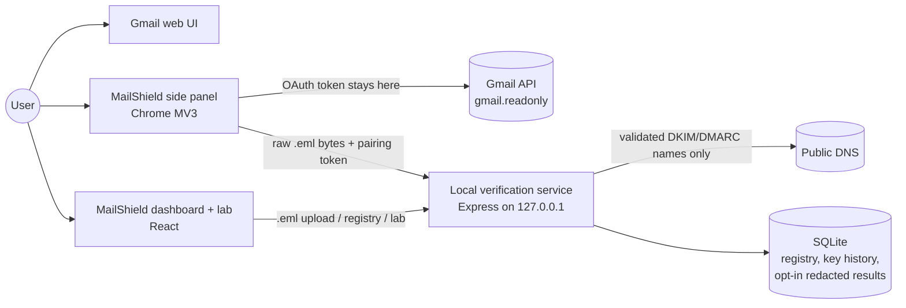
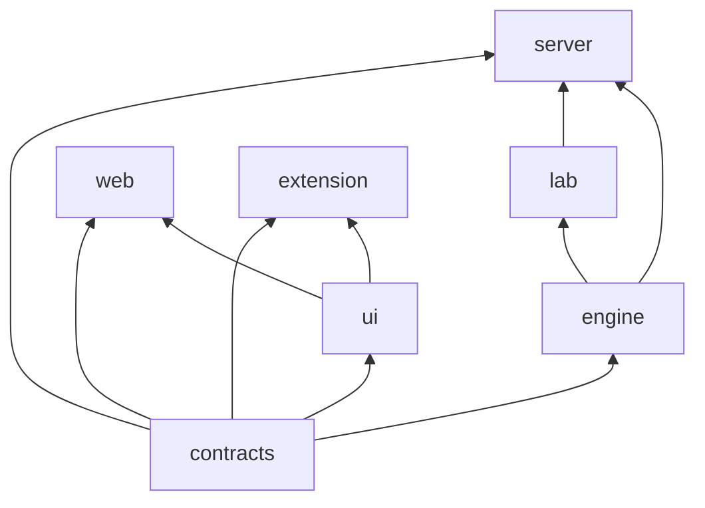
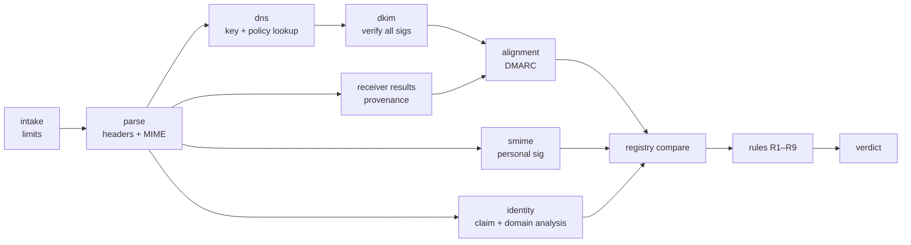
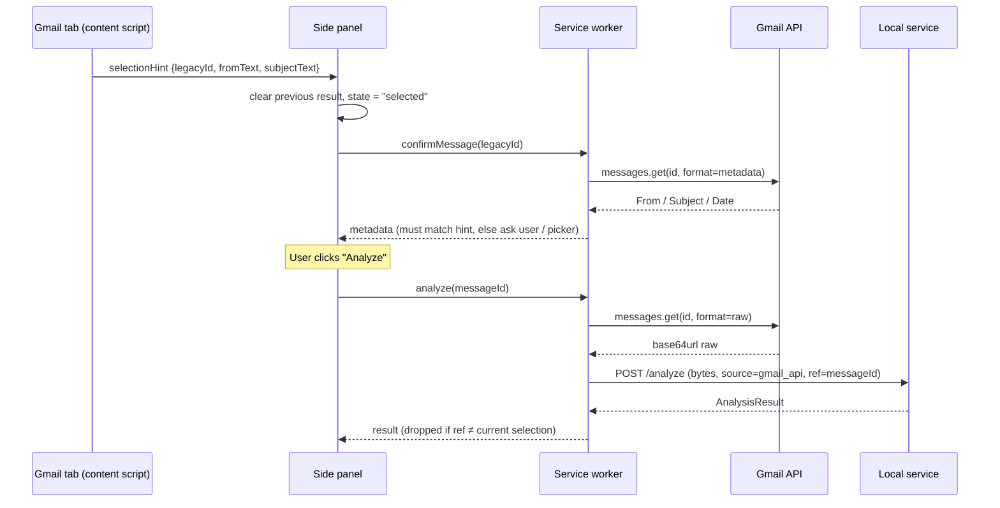
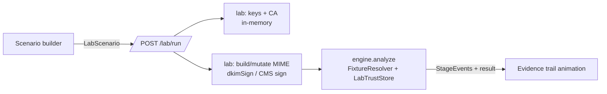

# MailShield — Architecture (Node.js / TypeScript)

> Companion to [`context.md`](context.md) (contract and invariants) and [`masterroadmap_plan.md`](masterroadmap_plan.md) (build order).
> Library capabilities marked **(verify P0)** must be confirmed in the Phase 0 spike before code depends on them.

---

## 1. System context



**Trust boundaries**

| Boundary | Crossing | Control |
|---|---|---|
| Gmail ↔ extension | OAuth token, raw message | `chrome.identity`, read-only scope, user-initiated fetch only |
| Extension/web ↔ local service | Raw bytes, registry edits | Pairing token, Origin allowlist, Host check, body limits, rate limit |
| Local service ↔ DNS | TXT queries | Name validation (only `_domainkey`, `_dmarc`, SPF), timeouts, lookup budget |
| Email content ↔ everything | Untrusted input | Parsed, never executed; previews sanitized in a sandboxed iframe; no URL fetching |
| Lab ↔ live | Keys, CA, fixture DNS | Separate package, separate trust store, separate resolver; never imported by the live pipeline |

---

## 2. Monorepo structure

```text
mailshield/
├─ package.json                 # root scripts: dev, build, test, lint, typecheck, eval
├─ tsconfig.base.json
├─ apps/
│  ├─ server/
│  │  └─ src/
│  │     ├─ server.ts           # bootstrap, bind 127.0.0.1
│  │     ├─ app.ts              # buildApp(deps) for tests
│  │     ├─ config.ts           # env parsing (zod), limits, allowed origins
│  │     ├─ middleware/
│  │     │  ├─ host-guard.ts    # reject Host ≠ 127.0.0.1/localhost:PORT
│  │     │  ├─ origin-guard.ts  # allowlist chrome-extension://<id>, dashboard origin
│  │     │  ├─ pairing-auth.ts  # bearer token check (constant-time compare)
│  │     │  ├─ errors.ts        # typed failures → problem+json
│  │     │  └─ redact-logger.ts # pino with redaction paths; never logs bodies
│  │     ├─ routes/             # analyze, identities, keys, lab, fixtures, evaluation, health
│  │     └─ db/
│  │        ├─ schema.ts        # drizzle tables
│  │        ├─ migrations/
│  │        └─ repositories/    # RegistryRepo, KeyHistoryRepo, ResultRepo
│  ├─ web/
│  │  └─ src/
│  │     ├─ routes/             # Overview, Analyze, Registry, KeyHistory, Lab, Evaluation, Settings
│  │     ├─ features/inspector/ # 3-column inspector, DKIM/domain inspectors, raw header viewer
│  │     ├─ features/lab/       # scenario builder, mutation controls, evidence trail
│  │     └─ api/                # typed client generated from contracts
│  └─ extension/
│     ├─ manifest.json          # MV3, side_panel, identity, fixed "key"
│     └─ src/
│        ├─ background.ts       # service worker: OAuth, Gmail fetch, POST to service
│        ├─ content/gmail.ts    # selection hint from DOM (read-only, no injection into mail body)
│        └─ sidepanel/          # React app reusing packages/ui
├─ packages/
│  ├─ contracts/                # zod schemas: AnalysisResult, Evidence, Finding, Identity, LabRun...
│  ├─ engine/
│  │  ├─ data/confusables.txt   # UTS #39 data, version recorded
│  │  └─ src/
│  │     ├─ intake/             # limits, InputSource, raw Buffer handling
│  │     ├─ parse/              # raw-headers.ts, addresses.ts, mime.ts, links.ts
│  │     ├─ dns/                # Resolver port, LiveResolver, cache, name validation
│  │     ├─ authentication/     # dkim.ts, receiver-results.ts, dmarc.ts, smime.ts, fingerprint.ts
│  │     ├─ identity/           # domain.ts, confusables.ts, similarity.ts, matcher.ts, RegistryPort
│  │     ├─ rules/              # r1..r9, rule-config.ts (versioned), verdict.ts
│  │     ├─ pipeline.ts         # orchestrates stages, emits StageEvents
│  │     └─ index.ts            # analyze(raw, deps) → AnalysisResult
│  ├─ lab/
│  │  └─ src/                   # key generation, dkimSign, lab CA, S/MIME signing,
│  │                            # FixtureResolver, scenarios, mutations
│  └─ ui/                       # VerdictCard, EvidenceCard, FindingItem, StatusBadge (icon+text)
├─ fixtures/
│  ├─ eml/{dev,heldout}/*.eml
│  ├─ dns/*.json                # fixture DNS zones
│  ├─ labels/*.json             # expected verdict/findings per fixture
│  └─ keys/                     # TEST-ONLY keys, clearly named
├─ tools/
│  ├─ gen-fixtures.ts           # regenerates signed fixtures deterministically
│  └─ evaluate.ts               # CLI: run engine over fixtures → metrics JSON
└─ docs/                        # threat-model.md, api.md, decisions.md, test-report.md, demo.md
```

**Dependency direction (enforced with ESLint `import/no-restricted-paths`):**



`engine` never imports `lab`, `server` or any HTTP/DB code. `server` passes the lab package only to the `/lab` routes.

---

## 3. The analysis engine

### 3.1 Entry point and dependency injection

```ts
// packages/engine/src/index.ts
export interface EngineDeps {
  resolver: DnsResolver;          // LiveResolver in prod, FixtureResolver in lab/tests
  registry: RegistryPort;         // read-only view of trusted identities
  keyHistory?: KeyHistoryPort;    // for R8 first-contact / key change
  trustStore: SmimeTrustStore;    // live store (empty by default) or lab store
  clock: () => Date;              // fixed in tests/lab for determinism
  config: RuleConfig;             // versioned thresholds and enabled checks
  onStage?: (e: StageEvent) => void;
}

export async function analyze(input: AnalysisInput, deps: EngineDeps): Promise<AnalysisResult>;

export interface AnalysisInput {
  raw: Buffer;                    // original bytes, never mutated
  source: 'gmail_api' | 'eml_upload' | 'header_paste' | 'lab' | 'fixture';
  headerOnly?: boolean;
}
```

### 3.2 Pipeline stages



Each stage emits:

```ts
interface StageEvent {
  stage: 'intake'|'parse'|'dns'|'dkim'|'receiver'|'alignment'|'smime'|'identity'|'registry'|'rules'|'verdict';
  status: 'pending'|'running'|'pass'|'fail'|'warn'|'skipped'|'not_evaluated'|'error';
  startedAt: string; durationMs?: number;
  inputs: Record<string, unknown>;   // summaries only, no raw bodies
  outputs: Record<string, unknown>;
  limitations: string[];
  simulated: boolean;                 // true only for lab-provided inputs
}
```

The dashboard pipeline view, the lab animation and test assertions all read these events. A stage that hasn't run shows `pending`, never `pass`.

### 3.3 Parsing (`parse/`)

- **Raw header reader:** splits the original `Buffer` at the first blank line, unfolds header lines and keeps *every* occurrence in order, with its byte offset. This is the authoritative view for provenance (A-R/Received ordering).
- **`postal-mime`:** structured body/attachment view for display and link extraction only.
- **Addresses:** parse `From`, `Sender`, `Reply-To`, `Return-Path`; decode RFC 2047 encoded words; IDN domains normalized with UTS #46. Multiple `From` headers or multiple mailboxes in `From` give `identity_status = ambiguous` plus an R6 finding.
- **Links:** `htmlparser2` walks `<a>` elements and records `{visibleText, href, hrefHost, textHost}`. No rendering, no fetching.

### 3.4 DNS (`dns/`)

```ts
interface DnsResolver {
  txt(name: ValidatedDnsName): Promise<DnsAnswer>;   // { records, ttl, status: 'ok'|'nxdomain'|'nodata'|'timeout'|'servfail' }
}
```

- `ValidatedDnsName` is a branded type that can only be created by `validateAuthName()`. It accepts only `<sel>._domainkey.<domain>`, `_dmarc.<domain>` and SPF-target domains, checks LDH labels and length, and rejects IP literals and single-label names.
- `LiveResolver`: `node:dns/promises` `Resolver` with a 3 s timeout and 2 tries, TTL-aware `lru-cache`, and a per-analysis lookup budget (e.g. ≤ 20 queries).
- `FixtureResolver` (in `packages/lab`): answers from `fixtures/dns/*.json`; unknown names give `nxdomain`. Can simulate `timeout`.
- Adapter to `mailauth`: its `resolver(name, rrtype)` option is wrapped so that every query passes through validation and the budget. **(verify P0: mailauth resolver signature and error-code expectations.)**

### 3.5 DKIM (`authentication/dkim.ts`)

1. Collect all `DKIM-Signature` headers from the raw reader and parse tags (`v a b bh c d h i l q s t x`) for display.
2. Call `mailauth`'s `dkimVerify(raw, { resolver })` once. It verifies every signature. **(verify P0: per-signature output fields such as status, body hash comparison and public key.)**
3. For each signature produce `SignatureEvidence`:
   - `status` from the library (`pass`/`fail`/`neutral`/`temperror`/`permerror`), mapped to our vocabulary.
   - `failureStage`: `dns` | `key_parse` | `body_hash` | `header_signature` | `expired` | `policy`, derived from library comments and our own checks (we recompute nothing cryptographic ourselves).
   - `coverage`: signed header list vs present headers. Important headers that are unsigned (`Subject`, `Reply-To`, `To`) are flagged. `l=` gives partial-body coverage in bytes.
   - `key`: type, bit size, `key_fingerprint` (SPKI DER SHA-256), `t=y` testing flag.
   - `weak`: RSA < 1024 gives fail/unsupported, < 2048 gives a warning; `rsa-sha1` is flagged as weak.
4. Results with `source = local_crypto`, `observedAt = clock()`.

### 3.6 Receiver results and DMARC

- `receiver-results.ts` implements the live-Gmail strategy from `context.md` §7. For `source ≠ gmail_api` it always returns `untrusted_header` records (shown for information, never used in verdict logic).
- `dmarc.ts`:
  - **Local partial alignment:** does any *locally verified* DKIM `d=` align (relaxed/strict per discovered policy) with the From domain? Labelled `partial (DKIM-only)`, because SPF can't be independently verified for uploads.
  - **Policy discovery:** via `mailauth`'s DMARC support, using the same resolver. **(verify P0: whether mailauth follows RFC 9989 tree-walk discovery or PSL. The UI must state which one we used.)**
  - **Receiver DMARC:** shown separately when `trusted_receiver`.
  - SPF is evaluated **only** in fixtures that provide trusted `{ip, helo, mailFrom}` envelope metadata.

### 3.7 S/MIME (`authentication/smime.ts`, P1)

- Detect `multipart/signed; protocol="application/pkcs7-signature"` and `application/pkcs7-mime; smime-type=signed-data`.
- Extract the **exact signed MIME part bytes** from the raw buffer (not re-serialized).
- `pkijs.SignedData.verify({ signer: 0, data, trustedCerts, checkDate })` gives the math result plus the chain result.
- Separate outputs: `signature_valid`, `chain_trusted` (against the injected trust store only), `email_binding` (cert SAN rfc822Name equals From address), `eku_email_protection`, `time_valid`, `revocation: 'unknown'` unless evidence is present.
- Key fingerprint compared with the registry `PublicKeyRecord` for the claimed person.
- Cross-checked in tests against `openssl cms -verify`.

### 3.8 Identity and domain analysis (`identity/`)

- `domain.ts`: `tldts.parse()` gives `{hostname, domain (registrable), subdomain, publicSuffix}`. Both Unicode and Punycode forms are kept. Matching is `registrable === approved || hostname endsWith '.' + approved` (label boundary) **only when** the registry entry allows subdomains.
- `confusables.ts`: NFD → map each code point through `confusables.txt` → NFD gives the skeleton. Script detection via `\p{Script=...}` regex for mixed-script flags. Legitimate single-script IDNs are not penalized.
- `similarity.ts`: OSA/Damerau distance on the registrable label (without the TLD), with the threshold scaled by length (≤1 for ≤6 chars, ≤2 otherwise), plus token comparison (`micros0ft-support` → tokens).
- `matcher.ts`: claimed identity = best registry match on display-name/alias (normalized: case-fold, NFKC, whitespace and punctuation collapsed) **or** on domain. Returns candidates with reasons; never more than a top-N against the registry, so no global database is needed.

### 3.9 Rules and verdict (`rules/`)

```ts
interface Rule { id: `R${number}`; version: string; run(ctx: RuleContext): Finding[] }
```

`RuleContext` holds the parsed message, all evidence, registry candidates, key history and config. Rules are pure and ordered. Correlated findings are grouped (e.g. R3 and R4 on the same domain become one card with two reasons).

**Verdict decision table** (first matching row wins):

| # | Condition | Verdict | identity_status | risk_level |
|---|---|---|---|---|
| 1 | Any `high` finding from R1, R2-mismatch or R3-strong | Possible impersonation | `mismatch` | `high` |
| 2 | Malformed/multiple From | Authentication concern | `ambiguous` | `caution` |
| 3 | Trusted DMARC fail, or invalid DKIM for the From domain with no other passing aligned signature | Authentication concern | `unverified` | `caution` |
| 4 | Registry match + aligned locally verified DKIM (or trusted personal sig) + no `caution` findings | No concerning identity mismatch found | `corroborated_*` | `low` |
| 5 | Registry match + aligned evidence + `caution` findings | Identity unverified (with cautions) | `corroborated_*` | `caution` |
| 6 | Everything else (no registry match, missing/unknown evidence, header-only) | Identity unverified | `unverified` | `unknown` / `caution` |

Every result carries `limitations[]`, e.g. “Header-only input: body signature not checked”, “DMARC evaluated from DKIM only”, “DNS key unavailable now; historical result may differ”.

---

## 4. Data contracts (`packages/contracts`)

```ts
const Evidence = z.object({
  id: z.string(),
  kind: z.enum(['dkim','spf','dmarc','arc','smime','registry','domain','link','receiver']),
  source: z.enum(['local_crypto','trusted_receiver','untrusted_header','registry','heuristic','lab']),
  status: z.enum(['pass','fail','missing','unknown','temporary_error','unsupported','untrusted','not_evaluated']),
  domains: z.array(z.string()),
  coverage: z.record(z.unknown()).optional(),
  reason: z.string(),
  observedAt: z.string().datetime(),
  details: z.record(z.unknown()),
});

const Finding = z.object({
  ruleId: z.string(), ruleVersion: z.string(),
  severity: z.enum(['high','caution','info','low']),
  title: z.string(), observed: z.string(), expected: z.string().optional(),
  evidenceRefs: z.array(z.string()),
  explanation: z.string(), recommendation: z.string(),
});

const AnalysisResult = z.object({
  analysisId: z.string().uuid(), schemaVersion: z.literal('1'),
  inputSource: z.enum(['gmail_api','eml_upload','header_paste','lab','fixture']),
  messageRef: z.string().optional(),        // gmail message id, for stale-result protection
  sender: SenderView, claimedIdentity: ClaimedIdentity.nullable(),
  authentication: z.array(Evidence), signatures: z.array(SignatureEvidence),
  findings: z.array(Finding), stages: z.array(StageEvent),
  verdict: z.enum(['possible_impersonation','authentication_concern','identity_unverified','no_concerning_mismatch']),
  identityStatus: IdentityStatus, riskLevel: RiskLevel,
  limitations: z.array(z.string()), analyzedAt: z.string().datetime(),
});
```

Typed failures (`application/problem+json`): `malformed_message`, `input_too_large`, `mime_limits_exceeded`, `dns_timeout`, `unsupported_crypto`, `unauthorized`, `origin_rejected`. When it can, the service returns a partial result with the failure attached instead of failing the whole analysis.

---

## 5. Local service

### 5.1 API

| Method & path | Body / query | Notes |
|---|---|---|
| `POST /api/v1/analyze` | `application/octet-stream` raw bytes (≤ 10 MiB), header `X-MailShield-Source`, optional `X-MailShield-Message-Ref` | Ephemeral by default |
| `POST /api/v1/analyze/headers` | `text/plain` headers | `headerOnly=true`; body/signature checks are `not_evaluated` |
| `GET/POST /api/v1/identities` | Identity JSON | Organizations and persons |
| `PATCH/DELETE /api/v1/identities/:id` | Partial / none | UI confirms first; soft-delete keeps an audit row |
| `POST /api/v1/identities/:id/keys` | PEM cert / SPKI public key + provenance | Rejects anything containing a private key block |
| `GET /api/v1/keys/history` | `?domain=&selector=` | Key observations |
| `POST /api/v1/lab/run` | `LabScenario` (allowlisted ids + mutation list) | Runs the engine with lab deps |
| `GET /api/v1/fixtures` · `POST /api/v1/evaluation/run` | split = dev / heldout | Metrics from real runs |
| `GET /api/v1/health` | none | `{status, version}` only |
| `POST /api/v1/pair` | pairing code | Exchanges the one-time code for a session token |

### 5.2 Request security pipeline (Express middleware, in order)

1. **Host guard**: `Host` must be exactly `127.0.0.1:<port>` or `localhost:<port>` (DNS-rebinding defence).
2. **Origin guard**: `Origin` must be in the allowlist (`chrome-extension://<fixed-id>`, the dashboard origin). Requests with a missing Origin are allowed only from the CLI with the token.
3. **Pairing auth**: `Authorization: Bearer <token>`, compared with `crypto.timingSafeEqual`. On first start the server generates a 6-word / 8-digit pairing code, printed to the console; the extension and dashboard exchange it once via `/pair` for a 256-bit session token, which they keep in `chrome.storage.local` / `sessionStorage`. Tokens are revocable from Settings.
4. **Rate limit + body limit** (`express-rate-limit`; `express.raw({ limit: '10mb' })` is mounted only on the routes that need it, after auth).
5. **Zod validation** of every body and param.
6. **Redacting logger**: pino with redaction of `req.body`, `authorization` and `cookie`; route handlers log only analysis ids and timings.

### 5.3 Persistence (Drizzle / SQLite)

```mermaid
erDiagram
    IDENTITY ||--o{ IDENTITY_ALIAS : has
    IDENTITY ||--o{ APPROVED_DOMAIN : has
    IDENTITY ||--o{ TRUSTED_ADDRESS : has
    IDENTITY ||--o{ PUBLIC_KEY_RECORD : has
    PUBLIC_KEY_RECORD ||--o{ KEY_OBSERVATION : observed_as
    RULE_CONFIG ||--o{ AUDIT_EVENT : changes
    IDENTITY ||--o{ AUDIT_EVENT : changes
    REDACTED_ANALYSIS }o--|| RULE_CONFIG : produced_with

    IDENTITY { text id PK; text kind "organization|person"; text display_name; text trust_state; text provenance_url; text notes; datetime last_reviewed; datetime created_at; datetime updated_at }
    APPROVED_DOMAIN { text id PK; text identity_id FK; text domain_ascii; bool include_subdomains; text relationship "own|service_provider" }
    PUBLIC_KEY_RECORD { text id PK; text identity_id FK; text key_type; text fingerprint_sha256 UK; text trust_source; text status; datetime enrolled_at; datetime expires_at }
    KEY_OBSERVATION { text id PK; text domain; text selector; text fingerprint_sha256; datetime first_seen; datetime last_seen; text status "current|rotated|unexpected|revoked" }
```

- Raw messages, bodies and private keys are **not** stored. `REDACTED_ANALYSIS` (opt-in only) holds the verdict, findings, domains and fingerprints, with no subject or body.
- Every registry change writes an `AUDIT_EVENT` (who, when, before, after).
- Lab data lives in an **in-memory** store per lab session and is never written to this DB.

---

## 6. Chrome extension



- **Manifest permissions:** `sidePanel`, `identity`, `storage`. `host_permissions`: `https://mail.google.com/*` (content script), `https://gmail.googleapis.com/*`, `http://127.0.0.1:<port>/*`. `oauth2.scopes`: `gmail.readonly` only.
- The content script **only reads** DOM attributes for the selection hint; it never modifies the Gmail UI or message content.
- Side panel states: `disconnected → connected → selected → confirming → ready → analyzing(stage) → result | error`. There's also a *Disconnect* action (`chrome.identity.removeCachedAuthToken` plus revoke guidance).
- **Fallback path:** a drag-and-drop `.eml` zone in the side panel and dashboard.

---

## 7. Dashboard and lab (frontend)

- **Routing:** `/` Overview (real counts from local session only), `/analyze`, `/registry`, `/keys`, `/lab`, `/evaluation`, `/settings`.
- **Inspector:** a 3-column layout (identity preview | evidence pipeline | findings), switching to tabs below `lg`. The raw header viewer escapes text, supports search and expands repeated headers.
- **Message preview:** sanitized HTML is rendered in `<iframe sandbox>` with `srcdoc` and CSP `default-src 'none'; style-src 'unsafe-inline'; img-src data:`. Remote images are replaced with placeholders.
- **Status language** (`packages/ui`): every status is shown as an icon + text + colour. Colour is never the only signal.
- **Lab:** the scenario builder produces a `LabScenario` (base fixture id + mutations such as `editBody`, `changeSignedSubject`, `alterUnsignedHeader`, `removeSignature`, `swapKey('eve')`, `rotateSelector`, `dnsMissing`, `dnsTimeout`). The server re-signs or mutates **real bytes** in `packages/lab`, runs the real engine with `FixtureResolver` and the lab trust store, and returns `StageEvent[]`. The UI animates those events (play/pause/step/speed). Protection toggles set `config.enabled.*=false`, and those stages emit `not_evaluated`.

### Lab data flow



---

## 8. Testing architecture

| Layer | Tool | What |
|---|---|---|
| Engine unit | Vitest | Header parsing, address decoding, domain boundaries, skeletons, similarity, alignment, each rule (+/−), verdict table rows |
| Crypto integration | Vitest + real signed fixtures + `FixtureResolver` | DKIM pass/fail/tamper/l=/multi-sig/rotated key/missing key/timeout; S/MIME valid/untrusted/tampered/wrong-key; OpenSSL cross-check |
| Security regression | Vitest | Each invariant in `context.md` §8 has a named test (`invariant-03-forged-auth-results.test.ts`) |
| Server | Vitest + `supertest` | Host/Origin/token rejection, body limits, problem+json shapes, no body in logs (log capture) |
| E2E | Playwright | Upload → inspect → edit registry → reanalyze; lab mutation; extension side panel loaded unpacked with a mocked Gmail API |
| Evaluation | `tools/evaluate.ts` | Fixtures × labels → confusion matrix (binary subset), precision/recall/F1 with denominators, unknown rate, failure list → JSON consumed by the Evaluation page |

Fixtures are generated **deterministically** by `tools/gen-fixtures.ts`, using a fixed clock and committed test-only keys, so they can be regenerated and reviewed.

---

## 9. Runtime and deployment

- `npm run dev` runs the server (`tsx watch`, `127.0.0.1:8787`), the web app (Vite `5173`) and the extension (Vite + crxjs, loaded unpacked from `apps/extension/dist`).
- `.env.example`: `PORT`, `ALLOWED_ORIGINS`, `EXTENSION_ID`, `DB_PATH`, `DNS_TIMEOUT_MS`, `RETENTION=off`. It contains no secrets. The OAuth client ID goes in the manifest; it is not a secret, but it is kept out of git if the team prefers (`manifest.local.json`).
- Optional `docker compose up` runs the server only. The extension and Gmail OAuth always run in the user's Chrome.

---

## 10. Known risks and mitigations

| Risk | Mitigation |
|---|---|
| `mailauth` lacks a diagnostic field we want | Derive the stage from its status/comment; never fake internals. Document the gap. |
| Gmail DOM selection unstable | Metadata confirmation step + picker + Show-original fallback. |
| OAuth restricted scope / consent hurdles | Test-mode consent with listed test users; spike in Week 1; documented blocker if it fails. |
| DMARC org-domain method (PSL vs RFC 9989 tree walk) | Verify the library in P0; show the method in the UI; test both on fixtures. |
| S/MIME byte extraction errors (CRLF, boundaries) | Extract from raw buffer offsets; OpenSSL cross-check tests. |
| Lab code leaking into live mode | Package boundary lint rule + runtime assertion that the live resolver is `LiveResolver`. |
| Over-claiming in UI copy | Copy reviewed against the glossary; “safe” banned by a lint check over UI strings. |
