# MailShield — Master Roadmap Plan

> Build plan for the Node.js/TypeScript implementation described in [`context.md`](context.md) and [`architecture.md`](architecture.md).
> **Team:** Member A = security engineering · Member B = application engineering.
> **Timeline:** 8 phases over ~7 weeks plus a stretch phase. Weeks are relative to kickoff; compress or stretch them to your real deadline, but **keep the phase order**. Never start a later phase's P1/P2 work while an earlier P0 exit criterion is red.

---

## Overview

| Phase | Name | Weeks | Priority | Headline outcome |
|---|---|---|---|---|
| 0 | Foundations & feasibility spikes | W1 (first half) | P0 | Monorepo runs; libraries and OAuth proven or blockers documented |
| 1 | Vertical slice: `.eml` → DKIM → result | W1–W2 | P0 | Upload a real email, see real DKIM evidence in the browser |
| 2 | Identity registry & domain analysis | W2–W3 | P0 | Registry CRUD; domain boundaries, confusables, lookalikes |
| 3 | Rule engine, verdicts & inspector | W3–W4 | P0 | R1–R9, verdict table, full inspector UI |
| 4 | Gmail extension | W4–W5 | P0 | Side panel analyzes a real message in a test account |
| 5 | Security laboratory | W5 | P0 | Offline lab with real signing, mutations, animated evidence trail |
| 6 | Personal signatures & key history | W6 | P1 | S/MIME Alice/Bob/Eve, key rotation, redacted reports |
| 7 | Evaluation, hardening & delivery | W6–W7 | P0/P1 | 40+ labelled fixtures, metrics, security review, docs, viva |
| 8 | Stretch | after W7 | P2 | OpenPGP, ARC UI, Workspace add-on, heuristic score |

```mermaid
gantt
    dateFormat  X
    axisFormat  W%s
    section P0 core
    Phase 0 Foundations        :p0, 0, 1
    Phase 1 Vertical slice     :p1, 1, 2
    Phase 2 Registry & domains :p2, 2, 3
    Phase 3 Rules & inspector  :p3, 3, 4
    Phase 4 Gmail extension    :p4, 4, 5
    Phase 5 Security lab       :p5, 5, 6
    section P1 advanced
    Phase 6 S/MIME & key history :p6, 6, 7
    section Delivery
    Phase 7 Eval, hardening, viva :p7, 6, 8
```

---

## Phase 0: Foundations & feasibility spikes (W1, days 1–3)

**Goal:** remove the biggest unknowns before writing product code.

| Member A (security) | Member B (application) |
|---|---|
| Spike `mailauth`: verify a real Gmail-downloaded `.eml` and a self-signed fixture; record the exact per-signature output fields, the resolver signature, error codes, and DMARC org-domain method (PSL vs RFC 9989 tree walk) | Create the npm workspaces monorepo: `apps/{server,web,extension}`, `packages/{contracts,engine,lab,ui}`, shared tsconfig, ESLint (with package-boundary rule), Prettier, Vitest, root scripts |
| Spike `pkijs`: verify an OpenSSL-produced S/MIME signed message, check chain against a custom root | Spike OAuth: Google Cloud project, Gmail API enabled, consent screen in *Testing*, Chrome-extension OAuth client bound to a fixed manifest `key`; `chrome.identity.getAuthToken` + `messages.get?format=raw` on a test account |
| Confirm `tldts`, `confusables.txt` data source/version, and `dns/promises` timeout behaviour | Scaffold Vite React app + Tailwind + Radix; scaffold MV3 side panel with crxjs |
| Draft `docs/threat-model.md` (assets, actors, trust boundaries) | Set up CI (GitHub Actions): typecheck, lint, test |

**Deliverables:** `docs/spikes.md` (findings, library versions pinned, any gaps), running `npm run dev`, CI green, `docs/decisions.md` started.
**Exit criteria:**
- [x] `mailauth` verifies a real DKIM signature through **our** resolver wrapper (locally signed and a real Gmail message).
- [x] OAuth spike fetched one raw message, **or** the exact blocker is documented and the Show-original fallback is confirmed as the demo path.
- [x] Every “(verify P0)” item in `architecture.md` is answered.

**Risk gate:** if `mailauth` can't take a custom resolver or lacks per-signature results, the fallback is a thin wrapper over its lower-level DKIM verifier, or the team re-decides the library (record an ADR). Don't proceed without this.

---

## Phase 1: Vertical slice — `.eml` → real DKIM evidence → result card (W1–W2)

**Goal:** the smallest end-to-end flow that is entirely real.

| Member A | Member B |
|---|---|
| `packages/contracts`: `Evidence`, `SignatureEvidence`, `StageEvent`, `AnalysisResult` (v1) | `apps/server`: Express app factory, config (zod env), Host guard, Origin guard, pairing auth, body limit, problem+json errors, redacting logger |
| `engine/intake`: size/MIME limits; `engine/parse`: raw header reader (repeated headers, offsets), address parsing with RFC 2047 + IDN, `postal-mime` integration | `POST /api/v1/analyze`, `/analyze/headers`, `/health`, `/pair` |
| `engine/dns`: `ValidatedDnsName`, `LiveResolver` with timeout/cache/budget, mailauth adapter | `apps/web`: Analyze page with drag-and-drop, progress, error/retry, raw JSON result view; pairing screen |
| `engine/authentication/dkim.ts`: all signatures, tag display, coverage (signed vs unsigned headers, `l=`), key type/size, SPKI fingerprint | `packages/ui`: `StatusBadge` (icon+text), `EvidenceCard`, minimal `VerdictCard` |
| Pipeline with `StageEvent` emission | Typed API client from contracts |
| | Analyze page: paste raw headers (unavailable checks shown) and “load demo” fixture; filename and size display; light/dark theme |
| First fixtures: `legit-signed`, `body-tampered`, `unsigned`, `missing-dns-key`, `dns-timeout` + `FixtureResolver` stub | |

**Deliverables:** upload an `.eml` in the dashboard and see each DKIM signature with real status, domain, selector, fingerprint and coverage.
**Exit criteria:**
- [x] A real Gmail-downloaded `.eml` shows DKIM `pass` (when its key is still published).
- [x] The tampered fixture shows `fail` at the body-hash stage.
- [x] Unsigned → `missing`; DNS timeout → `temporary_error`. No fake pass anywhere.
- [x] Server rejects wrong Host, wrong Origin, missing token, and bodies over 10 MiB (tests).
- [x] Logs contain no message content (log-capture test).

---

## Phase 2: Trusted identity registry & domain analysis (W2–W3)

**Goal:** know who the message *claims* to be, and what its domain really is.

| Member A | Member B |
|---|---|
| `identity/domain.ts`: tldts parse, Unicode/Punycode forms, boundary-aware matching with `include_subdomains` | DB: Drizzle schema + migrations for `Identity`, `IdentityAlias`, `ApprovedDomain`, `TrustedAddress`, `PublicKeyRecord`, `KeyObservation`, `AuditEvent` |
| `identity/confusables.ts`: UTS #39 skeleton + mixed-script detection | Routes: `GET/POST/PATCH/DELETE /identities`, `POST /identities/:id/keys` (rejects private keys) |
| `identity/similarity.ts`: OSA distance with length-scaled thresholds, token comparison | Registry UI: list/search/filter, org vs person, aliases/domains editor, trust-state badges, provenance fields, confirm dialogs, audit trail view |
| `identity/matcher.ts`: display-name/alias normalization and candidate ranking via `RegistryPort` | Import/export a validated registry JSON file |
| `authentication/receiver-results.ts` (untrusted for uploads) and `dmarc.ts` (local DKIM-only partial alignment + policy discovery) | Domain inspector UI: diff highlighting (not colour-only), code points, Punycode, registrable boundary |
| Unit tests: boundary cases (`brand.example.net`, `example.com.evil.net`), IDN, confusables | Seed registry with **fictional** orgs (Acme, Globex) on reserved domains; optional real brands only from reviewed official sites, with source URLs |

**Exit criteria:**
- [x] `micros0ft-support.example` and a Cyrillic-`а` variant are flagged against a registry entry, with the exact differing characters shown.
- [x] `acme.example.net` is **not** treated as `acme.example`.
- [x] A forged `Authentication-Results: mx.google.com; dkim=pass` in an upload is shown as `untrusted_header` (invariant test).
- [x] Registry changes are audited and need UI confirmation (audit covered by tests; the confirmation dialog has no E2E test until Playwright is set up).

---

## Phase 3: Rule engine, verdicts & message inspector (W3–W4)

**Goal:** turn evidence into explainable findings and a defensible verdict.

| Member A | Member B |
|---|---|
| `rules/`: R1–R7 + R9 (R8 needs key history; stub as `not_evaluated` until Phase 6) | Full inspector: 3-column desktop / tabs on mobile, identity comparison card (claimed vs actual, side by side) |
| Versioned `RuleConfig`, correlation/grouping of related findings | Findings accordion by severity, each with observed/expected/reason/safe next action |
| `rules/verdict.ts` implementing the decision table; `limitations[]` generation | Interactive authentication pipeline view driven by `StageEvent`s (click a stage to see inputs/outputs/duration/limitations) |
| `parse/links.ts` + R7 (href vs visible text, confusable hosts; no fetching) | DKIM inspector (select signature, field explanations, signed-header list, compare two signatures) |
| Fixtures: authenticated lookalike, trusted brand + DMARC fail, Reply-To divergence, link mismatch, `l=` partial, multi-signature, outsourced sender | Raw header viewer (escaped, search, repeated fields expandable, copy); sanitized preview in sandboxed iframe |
| Regression tests for every rule (+/−) and every verdict table row | Overview page with real local-session counts and empty states |

**Exit criteria:**
- [x] *Headline demo works:* a lookalike domain with **passing** DKIM for its own domain + display name “Acme Support” → **Possible impersonation**, explaining that the domain is authenticated but isn't Acme's.
- [x] Legit Acme fixture → “No concerning identity mismatch found” plus the limitation “domain identity, not personal authorship”.
- [x] Every verdict in the UI links to its findings and evidence (the verdict basis is tested in the engine; the UI links have no E2E test yet).
- [x] Preview loads no remote resources (Playwright network assertion).

---

## Phase 4: Gmail extension (W4–W5)

**Goal:** the daily-use experience inside Gmail.

| Member A | Member B |
|---|---|
| Live receiver-result trust strategy (topmost Google A-R above external `Received`), with tests on real downloaded Gmail messages | MV3 manifest (fixed key, minimal permissions), service worker: OAuth, `messages.get` metadata → raw, base64url decode, POST to service |
| Review extension permissions and data flow against the threat model | Content script: read-only selection hint from the Gmail DOM |
| Verify that `gmail_api` source is the only path to `trusted_receiver` (invariant test) | Side panel: connect/disconnect, consent explanation (“read-only can read all; we fetch only what you select”), selection confirmation, Analyze/Reanalyze, stage progress, verdict + identity + auth cards, findings, quick actions |
| | Stale-result protection (`messageRef` check); rapid-switch test |
| | Fallbacks: message picker (explicit consent), `.eml` drop zone, “Show original” instructions |
| | Side panel quick actions: open full report, view raw headers, copy fingerprint, open registry entry, mark finding reviewed (local); privacy settings. “Export redacted report” is enabled in Phase 6 |

**Exit criteria:**
- [ ] On a test account: open a message → panel confirms the From/Subject → Analyze → real result.
- [ ] Switching messages mid-analysis never shows the old result on the new message.
- [ ] OAuth denial and disconnect show actionable errors; the token is never sent to the server (code review + network test).
- [ ] If live OAuth is blocked, the blocker is written in `docs/spikes.md` and the fallback demo is rehearsed.

---

## Phase 5: Interactive security laboratory (W5)

**Goal:** the semester demonstration centrepiece. Offline, synthetic, and running real crypto.

| Member A | Member B |
|---|---|
| `packages/lab`: deterministic lab keys (Acme selectors `s2025`/`s2026`, Eve's key), `dkimSign`, MIME builder, `FixtureResolver` zones | Scenario builder: Alice/Acme vs Eve, edit display name/From/Reply-To/body/signing identity; side-by-side previews |
| Mutations on real bytes: edit body, change signed subject, alter unsigned header, remove signature, swap key, rotate selector, DNS missing/timeout | Mutation controls + protection toggles (disabled → `not_evaluated`) |
| `POST /lab/run` with allowlisted scenario IDs only; in-memory lab session; runtime assertion that the live paths never get lab deps | Animated evidence trail: play/pause/step/speed/reset, hover inspection; consumes real `StageEvent`s; “simulated” badges |
| Fingerprint/avalanche demo: same key/two messages, Eve's key, rotation; body digest vs key fingerprint shown separately | Before/after mode: standard auth only vs with registry rules |
| | Guided challenges + downloadable synthetic report + reset |
| | Scenario builder: change dummy avatar; compose a short local test message |

**Exit criteria:**
- [ ] Changing one character in the body flips DKIM to `fail` and shows a completely different body hash.
- [ ] Changing an **unsigned** header leaves DKIM `pass` and the UI explains why.
- [ ] Before/after mode shows the lookalike passing “standard auth” but triggering R1/R3 with rules on.
- [ ] Lab works with the network disabled.

---

## Phase 6: Personal signatures & key history (W6, P1)

**Goal:** go beyond domain identity to personal identity.

| Member A | Member B |
|---|---|
| `authentication/smime.ts` via pkijs: exact signed-part extraction, signature validity, chain vs injected trust store, email binding, EKU, time validity, revocation = unknown | Key enrollment UI: paste PEM, preview fingerprint, “compare via a separate channel” step, provenance, trust scope |
| Lab CA + Alice/Bob/Eve certificates (`@peculiar/x509`), CMS signing for lab messages | Personal signature card in inspector and side panel (valid / trusted / identity-bound shown separately) |
| R2 with enrolled keys; R8 first-contact/key-change using `KeyObservation` | Key History page: per domain+selector timeline, rotation vs unexpected change vs revoked |
| Key observation recording (opt-in) with rotation classification | Redacted report export (JSON + printable HTML), with no subject/body |
| OpenSSL `cms -verify` cross-check tests | Lab “personal verification challenge” flow |
| | Settings page: consent/privacy, history retention (off by default), rule sensitivity (audited), DNS behaviour, theme, local data deletion and reset, session token revocation |

**Exit criteria:**
- [ ] Alice's signed message with her key enrolled → `corroborated_personal`.
- [ ] Eve's valid-but-unenrolled signature → signature valid, identity **not** confirmed.
- [ ] Tampered S/MIME → fail; unsigned outer Subject is never described as personally signed.
- [ ] Lab CA is never trusted in live mode (invariant test).

---

## Phase 7: Evaluation, hardening & delivery (W6–W7)

**Goal:** prove it works, prove it's safe, and present it.

**Evaluation (A leads the fixtures, B leads the page)**
- ≥ 40 labelled synthetic fixtures across: legitimate (≥10), impersonation/lookalike (≥10), tampered (≥8), ambiguous/unknown (≥8), edge cases (forwarding, rotation, outsourced sender, shared name).
- Split into `dev/` and `heldout/`. Thresholds are tuned **only** on dev; held-out is run once for the report.
- `tools/evaluate.ts` → metrics JSON: confusion matrix (binary subset), precision/recall/F1 with denominators, unknown/abstention rate, false-positive list with explanations.
- Evaluation page renders only that JSON; a few authorized real messages are reported separately if available.

**Hardening (joint)**
- Walk every row of the acceptance table in `MailShield_context.md` §18 and every invariant in `context.md` §8; each maps to a passing test.
- Fuzz the parser with malformed MIME / deep nesting / huge headers (bounded time and memory).
- Dependency audit (`npm audit`), permission review of the manifest, UI copy review (no “safe”, no accusations).
- Accessibility pass: keyboard navigation, focus rings, contrast, reduced motion.

**Delivery**
- README (setup in < 10 commands), `docs/api.md`, `docs/threat-model.md`, `docs/test-report.md`, `docs/demo.md` (script from §20 of the original spec), architecture diagrams, a short demo recording, slides.
- Viva rehearsal: each member explains the other's module at a high level.

**Exit criteria:**
- [ ] All critical regression fixtures pass in CI.
- [ ] Dashboard and lab fully usable without Gmail.
- [ ] Unimplemented features are listed honestly in the README.

---

## Phase 8: Stretch (only after Phase 7 exit criteria are green)

- OpenPGP signature verification with OpenPGP.js and explicitly trusted keys.
- ARC chain validation shown as context only.
- Optional numeric heuristic indicator (documented weights, correlated-signal caps, labelled “heuristic, not probability”).
- Google Workspace add-on prototype (test current-message scopes first).
- Opt-in batch analysis of the N most recent messages, with an explicit consent dialog.

---

## Cross-phase checklists

**Definition of done (every PR)**
- Types, lint and tests green; new behaviour has a test; security claims have a fixture-backed regression test.
- No raw message content, tokens or keys in logs, fixtures (except test-only keys) or commits.
- UI states covered: loading, empty, error, `unknown`, `not_evaluated`.

**Weekly sync (30 min)**
1. Exit-criteria status per phase (red/amber/green).
2. Contract changes in `packages/contracts` (both must approve).
3. Risks/blockers → `docs/decisions.md`.

**Top risks**

| Risk | Phase | Plan B |
|---|---|---|
| Gmail OAuth blocked (restricted scope, consent, org policy) | 0/4 | Show original → `.eml` import; document the blocker |
| mailauth gaps | 0 | Lower-level verifier wrapper / ADR to change library |
| Time pressure | any | Cut P1 items in this order: redacted export, key-history UI, S/MIME lab challenge. **Never** cut P0 lab DKIM, the registry or the rules |
| Fixture keys expire / DNS changes for real emails | 1, 7 | Real messages are evaluated only for receiver context; crypto claims rely on deterministic fixtures |
